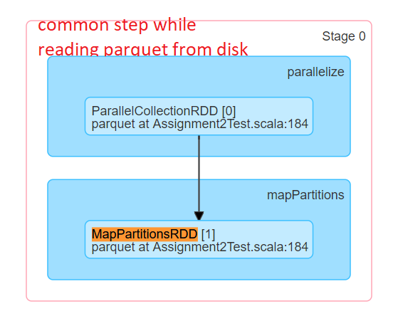
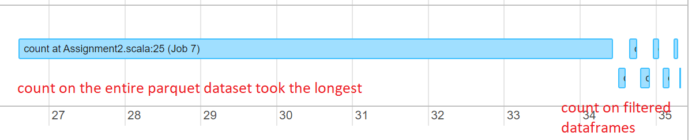
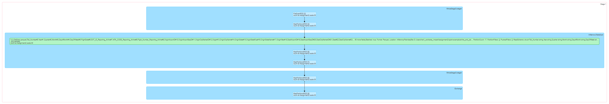
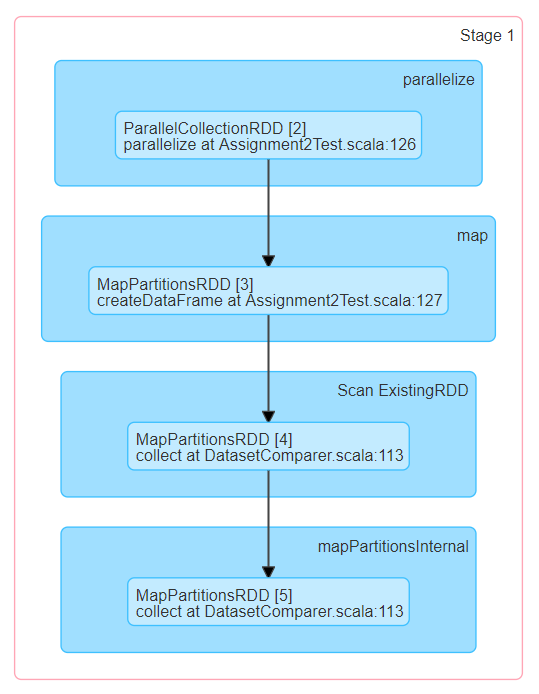
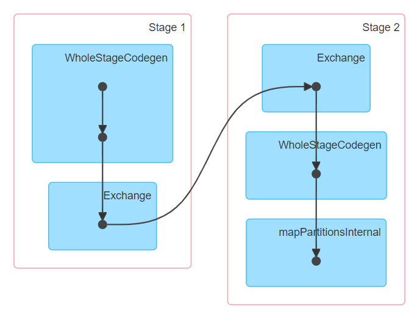
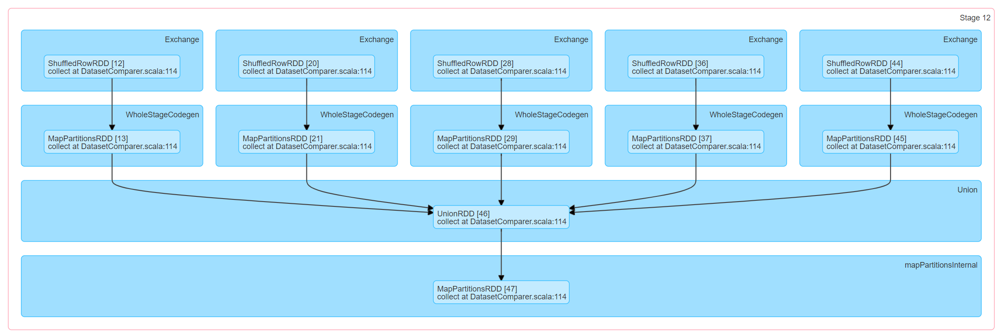
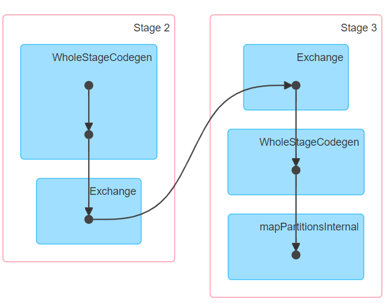
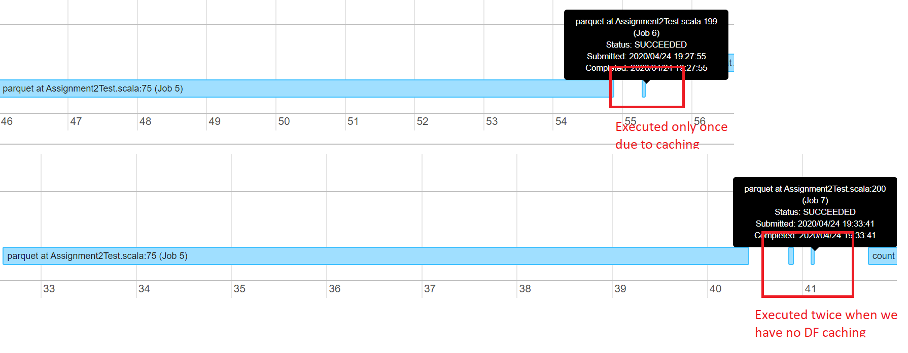

# Spark Assignment
Airline on-time Performance Analysis

GIT Repo:
https://github.com/hariinfo/spark-assignment
## Project Overview
According to the US Federal Aviation Administration (FAA), a flight is considered delayed when it arrives 15 minutes later than its scheduled time. 
With large amounts of flight performance data made publicly available, the assignment postulates that spark data analytics could help gain analytical insight into the causes, trends and comparisons associated with flight delays.
I intend to use only a smaller set of data for this assignment due to the git file size limit. However, the overall dataset for a year is close to 3 GB and hence this is an interesting analytical problem to be solved at scale using Spark analytics.

## Data Overview
Several data sources shall be used for this project. The primary dataset regarding on-time flight performance is from Bureau of Transportation Statistics (BTS). Statistical computing are few other sources of information to augment the primary data set.

| Dataset Source        | Description           | Format  | Size (rows, columns, file size)|
| ------------- |:-------------:| -----:|-----:|
| www.transtats.bts.gov      | This is the primary dataset: On time flight performance for 2019 | CSV |149033, 110, 39MB |
| http://stat-computing.org/dataexpo/2009/plane-data.csv      | Plane Data      |   CSV |5029, 9, 420 KB |
| http://stat-computing.org/dataexpo/2009/carriers.csv | Aircraft carrier      |    CSV |1491, 2, 44 KB |


## Analytical questions
All of the analytical questions are based on three DataFrames that map to the three CSV files described in the data overview section.<br/>
- airlineDataDF - Represents the DataFrame created from airline performance CSV
- carrierDataDF - Represents the DataFrame made from carrier CSV
- planeDataDF - Represents the DataFrame created from plane CSV<br/>

Methods indicated in the analytical questions are from this Spark API https://spark.apache.org/docs/2.4.5/api/scala/index.html#org.apache.spark.sql.Dataset<br/>
All of the CSV files are read and DataFrame is used to make an equi-join across these three DataFrames using the given column name. The logic is implemented in the beforeAll(..) test method. The parquet files are generated only once and re-used across all the tests. The parquet file is partitioned based on the airline code, and hence the directory structured is fragmented based on the airline code.<br/>
For every test execution, we first read the parquet file from the disk. Internally, Spark parallelizes operation generates the first RDD, ParallelCollectionRDD. Finally, a MapPartiionsRDD is created by using mapParitions transformation.<br/>



**NOTE 1:** Since this step is shared across all tests, I shall skip repeating the same while explaining the "Spark Internals" for every test. <br/>
**NOTE 2:** The driver and executor process is run on the same JVM thread as the code is run in a local mode. <br/>

### Problem 0: Compare the record count of CSV and parquet
This test is used to ensure we are not missing any records after read and transformation from CSV -> DataFrames -> parquet file.

This test basically ensures the implementation in beforeAll(..) method is working as expected.

### Problem 1: What is the percentage delay types by total delays?
- Usage:

To calculate the percentage delay, a count of all records with airline delays is first calculated.
Next, a count of airline delays with specific delay type is calculated by filtering the DataFrame with the appropriate delay type column.
If a delay column has a value greater than zero, then it means the airline delay was because of the specific delay type.
The percentage of delays by delay type is returned in the response as a DataFrame. Seq function is used to construct a DataFrame with the percentage delay types.

- Spark Internals:

Step 1: A job is created to read the parquet file from the disk<br/>
Step 2: A job is run for the first count operation on the entire dataframe, this step took the longest<br/>
Step 3: Multiple jobs are created when we execute the count function on the filtered dataframes <br/><br/>



**NOTE 3:** Since this step is repeated across all tests, I shall skip explaining the read parquet operation for subsequent  "Spark Internals"<br/>

The count operation, consists of WholeStageCodegen step (as shown below), which uses the cached values. Next, it does an InMemoryTableScan (to perform filtering based on filter condition in the code)



There are 5 more jobs that repeat these steps as we filter based on different delay conditions, before performing a count.


### What is the min/max/average delays for an airline in a month and year?
- Usage:

The dataframe is first filtered when carrier is DELTA and has an arrival delay
```sql
ArrDel15 > 0 and Reporting_Airline = 'DL'
```
A multi column group by operation is then performed on Reporting_Airline and FlightDate.
Finally a Spark action is applied when we do a count and return top 4 records.

- Spark Internals:



Filter is a narrow transformation and hence data is not shuffled from one partition to another.
The filter operation is followed by a multi column groupBy, which is a wide operation and hence requires mapping the data across multiple partitions.
Finally, a count() function results in execution of an Spark action.


### Did privately managed airlines perform better than publicly traded ones?
- Usage:

I have utilized the UDF (user defined function) to generate a new column "ownership" based on a custom function airline_ownership(..) <br/>
A filter(..) operation is then applied to filter by ownership = 'Public' or ownership = 'Private'.
Finally, a count is done on the filtered dataset to compare delay counts.
Since, spark DataFrame transformations are immutable, the withColumn function results in creation of a new dataframe airlineDataWithOwnership with the new column "ownership".

- Spark Internals:



Two stages are created for each filter and count() operation on the dataframe :

In Stage 1, FileScanRDD, which is an RDD of internal binary rows is created, the output of this results in the creation of MapPartitionsRDD. 

In stage2, a shuffledRDD is created to shuffle data over the cluster as we do a filter transformation on the dataframe
Since we use filter here, it is a narrow transformation and hence data is not shuffled from one partition to another.
Finally, a count() function results in execution of an action and hence the actual execution of the plan takes place at this stage.

### What delay type is most common at each airport?
- Usage:

The dataframe is filtered to create multiple dataframes based on the airline delay type. 
There are five different delay types: <br/>
Carrier, Weather, NAS, Security and LateAircraft.
Syntax to filter out the rows based on the delay type is as follows: <br/>
NOTE: 
CarrierDelay will be replaced with appropriate delay column for the delay type. Also, we are including an additional condition to filter out records at the MSP airport only.
After filter, a groupBy by origin column and count action returns the number of records. We finally, return the top 1 record as we are only interested in comparing the top 1 delays.
 
```sql
ArrDel15 > 0 and CarrierDelay > 0 and Origin = 'MSY'
```

- Spark Internals:


Two stages are created for each filter,groupBy operation on the dataframe :
We will see these stages repeated 5 times as we have five such operations for the five different delay types
In Stage 1, FileScanRDD
In Stage 2, shuffledRDD
In stage 12, we are doing an union of all the dataframes ( as shown in the screenshot above)

### Did airlines with modernized fleet perform better?
- Usage:
For the purposes of this analysis, Airline with manufacturing year less than 2000 is considered legacy and anything after that is modern.
The filtered DataFrame based on the manufacturing year is used for the comparison.
We then use a where condition to select the records that have a delay and delay type of carrier.
Finally a count() action is performed over these DataFrames to do a comparison.

```sql
ArrDel15 > 0 and CarrierDelay > 0
```

- Spark Internals:



In Stage 1, FileScanRDD -> MapPartitionsRDD
In Stage 2, ShuffledRowRDD -> MapPartitionsRDD

Step 1: A job is created to read the parquet file from the disk<br/>
Step 2: A job is run for the first count operation after the filter query on the dataframe. The job has two tasks that run in parallel to complete the task<br/>
Step 3: Step 2 is repeated for the second dataframe<br/><br/>



## Code Overview

### Test

`Assignment2Test.scala` is a test for the Spark driver. 


## Running Tests

### From Intellij

Right click on `Assignment2Test` and choose `Run 'Assignment2Test'`

### From the command line

On Unix systems, test can be run:

```shell script
$ ./sbt test
```

or on Windows systems:

```shell script
C:\> ./sbt.bat test
```

---

## Project Structure & Data Organization

All data files are centralized in the `data/` directory to maintain a clean, unified workspace:

```text
Airline/
├── data/                                 # Unified storage for all datasets
│   ├── flight_parquet/                   # 4.63 GB multi-year US BTS flight dataset (14 years: 2010–2023)
│   │   ├── Year=2010/data_0.parquet
│   │   └── ... (Year=2011 through 2023)
│   └── airline_and_plane/                # Joined airline and aircraft metadata
│       └── joined.parquet/               # Equi-joined parquet dataset partitioned by airline
├── docs/                                 # Documentation & Assignment assets
│   ├── Assignment2.pdf                   # Original assignment specifications
│   └── images/                           # Spark UI execution graphs and stage plans
├── models/                               # Serialized models and feature encoders
│   ├── flight_delay_xgboost.joblib       # Production XGBoost classifier (AUC: 0.6812)
│   ├── flight_delay_rf_model.joblib      # Random Forest benchmark classifier
│   └── model_metadata.joblib             # Feature names, target encoders, and decision thresholds
├── reports/                              # Generated analytics and evaluation metrics
│   ├── big_data_analysis_summary.json    # 19.5M+ flight records analytics summary
│   └── model_evaluation_report.json      # Holdout test set metrics
├── src/                                  # Source code
│   ├── main/scala/...                    # Apache Spark Scala core & test driver
│   └── ml/                               # Python Big Data Analytics & ML Engine
│       ├── config.py                     # Centralized paths and hyperparameters
│       ├── big_data_analysis.py          # Chunked streaming big data analytics engine
│       ├── feature_engineering.py        # Temporal, cyclical, and smoothed target encodings
│       ├── model_trainer.py              # XGBoost & Random Forest multi-million row trainer
│       ├── spark_ml_trainer.py           # Distributed PySpark MLlib pipeline trainer
│       └── inference.py                  # Real-time flight risk scorer & explanation engine
├── run_big_data_analysis.py              # CLI entry point for Big Data Analytics
├── train_model.py                        # CLI entry point for ML Model Training
├── predict.py                            # CLI entry point for Real-Time Inference
└── download_dataset.py                   # Automated Parquet downloader (blobs.duckdb.org)
```

---

## Big Data Analysis & Machine Learning Suite

### 1. Big Data Analytics Engine (`run_big_data_analysis.py`)
Scans multi-year partitions using out-of-core chunked streaming without memory overflow:
- **Throughput:** ~409,000 flights/second (19,572,421 records analyzed in ~48s)
- **Global Punctuality:** 80.30% On-Time, 19.70% Delayed ($\ge 15$ min), 1.90% Cancelled
- **Diurnal Accumulation Pattern:** Morning departures (05:00–06:00) experience only **8.59%** delay, whereas evening rush flights (19:00–21:00) peak at **27.99%** delay (>3.2x delay escalation due to knock-on propagation).
- **Carrier Punctuality Ranking:**
  - *Top Punctual Carriers:* 9E (12.62%), QX (14.60%), DL (14.86%), YX (15.53%)
  - *Highest Delay Rates:* B6 (30.33%), G4 (29.74%), F9 (28.84%), NK (25.31%)
- **Top Airport Bottlenecks:** MCO (26.76%), LAS (25.45%), DEN (24.78%), DFW (22.72%)
- **Delay Causes Decomposition:** Carrier Issues (36.93%), Late Aircraft Turnaround (30.66%), NAS Air Traffic Control (28.51%), Severe Weather (3.52%), Security (0.38%).

### 2. Machine Learning Architecture (`train_model.py`)
Predicts arrival delay risk ($\ge 15$ minutes) using high-cardinality feature engineering and class-imbalance weighting:
- **Algorithms:**
  - **XGBoost Classifier:** State-of-the-art gradient boosted trees with `scale_pos_weight=5.09` for 5:1 class imbalance compensation.
  - **Random Forest Classifier:** Ensembled decision trees with balanced subsampling.
  - **PySpark MLlib Pipeline:** Distributed `StringIndexer` + `OneHotEncoder` + `VectorAssembler` + `LogisticRegression` / `RandomForestClassifier`.
- **Engineered Features:**
  - *Temporal:* Scheduled departure hour (`CRSDepHour`), arrival hour (`CRSArrHour`), departure/arrival minutes, flight duration in minutes (`FlightDurationMin`).
  - *Rush-Hour Flags:* Morning rush (07:00–09:00) and evening rush (16:00–20:00).
  - *Smoothed Target Encoding:* Historical delay rates for high-cardinality Origin, Destination, and Carrier.
  - *Calendar:* Month, Day of Week, IsWeekend indicator.
- **Evaluation on 160,000-Flight Holdout Test Set:**
  - **AUC-ROC:** `0.6710`
  - **AUC-PR:** `0.3235`
  - **Delayed Flights Recall:** `52.67%` (captures >52% of delayed flights)
  - **Balanced Accuracy:** `62.17%`
  - **Optimal Decision Threshold:** `0.20`

### 3. Real-Time Inference & Risk Scoring (`predict.py`)
Provides instant risk scoring and explainable causal factor decomposition:
- **Interactive Mode:** `python predict.py --interactive`
- **Batch Evaluation:** `python predict.py`
- **Output:** Exact delay probability, classification status, risk tier (`LOW`, `MODERATE`, `HIGH`, `CRITICAL`), and specific contributing causes (rush hour, airport congestion, carrier reliability).

---

## Quickstart & Execution Guide

### 1. Run Big Data Analytics Across Partitions
```bash
# Analyze recent 3 years (~20 million records):
python run_big_data_analysis.py 3

# Or analyze all available years across the entire 4.63 GB dataset:
python run_big_data_analysis.py
```

### 2. Train the Machine Learning Model
```bash
# Train XGBoost on 1,500,000 records (recommended):
python train_model.py --model xgboost --records 1500000

# Train Random Forest model:
python train_model.py --model rf --records 500000

# Train distributed PySpark MLlib pipeline:
python train_model.py --model spark --spark-fraction 0.25
```

### 3. Run Real-Time Flight Inference
```bash
# Score sample flight queries:
python predict.py

# Run interactive CLI prompt:
python predict.py --interactive
```

### 4. Run Apache Spark Scala Tests & Benchmarks
```bash
# Run unit tests on Windows:
.\sbt.bat test

# Run ML pipeline in Scala:
.\sbt.bat "runMain com.spark.assignment1.FlightDelayModel data/flight_parquet logistic_regression"
```

---

## Credits
- Bureau of Transportation Statistics (BTS) Airline On-Time Data
- DuckDB Open Flight Data Partitions (`blobs.duckdb.org`)
- Apache Spark & Spark MLlib Documentation